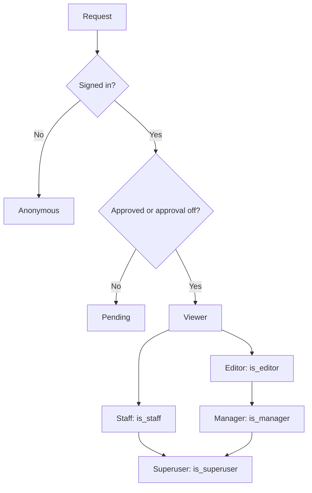

# Roles

A role is a set of powers. MediaCMS has six roles: anonymous, viewer, editor, manager, staff, and superuser. A signed-in user can also be in the pending state, which limits the user to reading.

| Role | Short description | Page |
|------|-------------------|------|
| Anonymous | A visitor who is not signed in. Browses listable media. | [Anonymous](anonymous.md) |
| Pending | A signed-in user who waits for approval. Reads only. | [Pending approval](pending.md) |
| Viewer | A signed-in user. Manages own media, comments, playlists, and shares. | [Viewer](viewer.md) |
| Editor | A viewer who can also open Manage media and Manage comments and review media. | [Editor](editor.md) |
| Manager | An editor who can also manage users. | [Manager](manager.md) |
| Staff | A user who can open the admin portal. | [Staff](staff.md) |
| Superuser | A staff user with full access, content migration, and site upgrade. | [Superuser](superuser.md) |

The pending state applies to a signed-in user when the setting `USERS_NEEDS_TO_BE_APPROVED` is `True`. Pending is not a separate permission flag.

To see all roles side by side, open [Compare roles](compare.md).

## How roles work

Each role maps to flags on the user account.

| Flag | Meaning |
|------|---------|
| `is_approved` | An approver accepted the account. Matters only when `USERS_NEEDS_TO_BE_APPROVED` is `True`. |
| `advancedUser` | The user can add media when `CAN_ADD_MEDIA` is `advancedUser`. |
| `is_editor` | The user is an editor. |
| `is_manager` | The user is a manager. |
| `is_staff` | The user can open the admin portal. |
| `is_superuser` | The user has every power. |

A manager has all editor powers. A superuser has all manager and editor powers. A staff user does **not** get Manage pages unless the user is also an editor, a manager, or a superuser.

## MediaCMS Architecture

Django checks the user flags on every request. The checks happen in the views and in the REST API.

## Next step

Read the page for your role, or open [Compare roles](compare.md).
