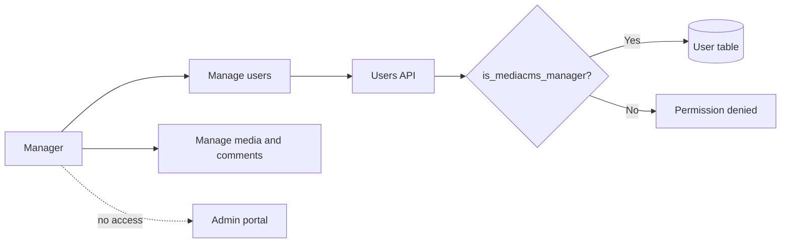

# Manager

A manager is a user with the flag `is_manager`. A manager has all editor powers and can also manage users.

## What a manager can do

- Do everything an [editor](editor.md) can do.
- Open **Manage users**.
- Approve and disapprove users when `USERS_NEEDS_TO_BE_APPROVED` is `True`.
- Assign the editor role and the `advancedUser` flag to users.
- Change the password of a user who is not a superuser.

## What a manager cannot do

- Open the admin portal at `/admin/`. A manager is not Django staff by default.
- Change the password of a superuser.
- Run a content migration or a site upgrade.

!!! note
    An administrator can give the same user the staff flag. Then the user can open the admin portal as well.

## Approve a user

1. Open **Manage users**.
2. Find the user. Use the approval filter to show users who wait for approval.
3. Select the user.
4. Select the approve action.
5. Check that the user shows as approved.

See [Manage users](../guides/operator/manage-users.md).

## MediaCMS Architecture

The helper `is_mediacms_manager` allows managers and superusers. The users API calls it before it approves a user.

## Scenarios

- [Manager approve user](../scenarios/manager-approve-user.md)
- [Manager assign editor](../scenarios/manager-assign-editor.md)
- [Manager admin refused](../scenarios/manager-admin-refused.md)
