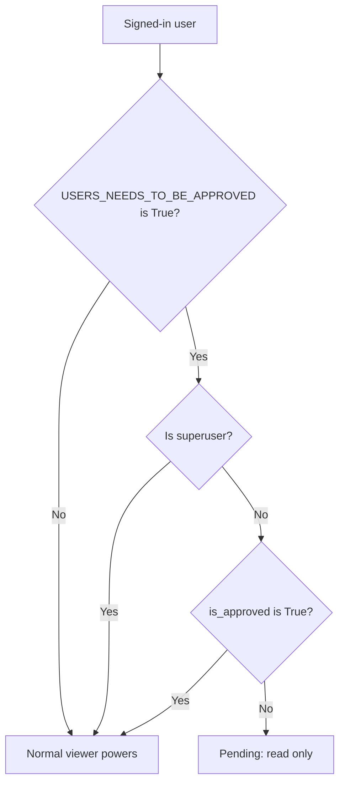

# Pending approval

A pending user is a signed-in user whose account is not approved yet.

## When a user is pending

A user is pending when all of these conditions are true:

1. The setting `USERS_NEEDS_TO_BE_APPROVED` is `True`.
2. The user is signed in.
3. The field `is_approved` is `False`.
4. The user is not a superuser.

Superusers skip the approval check.

## What a pending user can do

- Browse and play listable media.
- Read comments.
- Open the profile page.

## What a pending user cannot do

- Upload media.
- Edit media.
- Write comments or create playlists.
- Open Manage pages.

The portal refuses these actions. The portal does not block sign-in.

## Leave the pending state

A manager or a superuser must approve the account. They can use one of these ways:

1. Open **Manage users**. Use the approve action on the user.
2. Open the user in the admin portal. Select **Is approved**.
3. Edit the user profile. Select **Is approved**.

See [Manage users](../guides/operator/manage-users.md).

## MediaCMS Architecture

The function `user_is_pending_approval` in `files/methods.py` decides if a user is pending. The upload, edit, and Manage views call it and refuse a pending user. The middleware `ApprovalMiddleware` lets pending users through.

## Scenarios

- [Pending browse](../scenarios/pending-browse.md)
- [Pending upload refused](../scenarios/pending-upload-refused.md)
