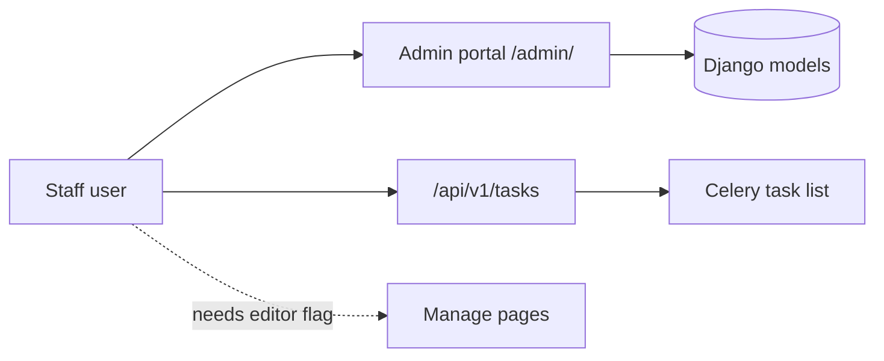

# Staff

A staff user has the Django flag `is_staff`. A staff user can open the admin portal.

## What a staff user can do

- Open the admin portal at `/admin/`. It shows a dashboard and the data tables.
- Work with the tools in the admin portal: moderation, library, processing, people, and integrations.
- Read and cancel tasks through the API at `/api/v1/tasks`.
- Do everything a [viewer](viewer.md) can do.

## What a staff user cannot do

- Open **Manage media**, **Manage users**, or **Manage comments**. These pages stay closed unless the user is also an editor, a manager, or a superuser.
- Run a content migration or a site upgrade. Only superusers can do this.

!!! note
    The admin portal limits each staff user to the model permissions that an administrator granted.

## Open the admin portal

1. Sign in as a staff user.
2. Open `/admin/` in the browser.
3. Look at the dashboard cards.
4. Select a card to open the related table.

See [Admin portal map](../guides/admin/portal-map.md) and [Processing](../guides/admin/processing.md).

## MediaCMS Architecture

The admin portal is the Django administration interface with the Jazzmin theme. The `/api/v1/tasks` endpoint uses the permission `IsAdminUser`, which checks `is_staff`. It lists and cancels Celery tasks.

## Scenarios

- [Staff dashboard](../scenarios/staff-dashboard.md)
- [Staff processing queue](../scenarios/staff-processing-queue.md)
