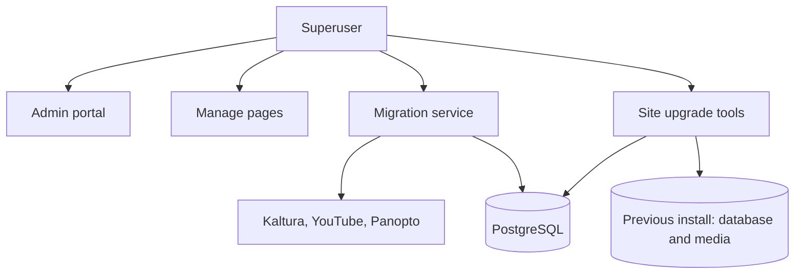

# Superuser

A superuser has the Django flag `is_superuser`. A superuser has all staff, manager, editor, and viewer powers. The first `admin` user is a superuser.

## What a superuser can do

- Do everything a [staff user](staff.md) can do.
- Open the Manage pages. A superuser counts as an editor and a manager.
- Skip the approval check, even when `USERS_NEEDS_TO_BE_APPROVED` is `True`.
- Change any user, including the password of another superuser.
- Run a **content migration** to import media from another platform.
- Run a **site upgrade** to move an existing install to a new MediaCMS version.

## Content migration

Content migration imports media from Kaltura, YouTube, or Panopto. Only superusers can start it.

See [Content migration](../guides/admin/content-migration.md).

## Site upgrade

Site upgrade moves an existing MediaCMS install to a new MediaCMS version. Only superusers can run it.

See [Site upgrade](../guides/admin/site-upgrade.md).

## Protect superuser accounts

1. Give the superuser flag to as few people as possible.
2. Use a strong, unique password for each superuser.
3. Do not share superuser accounts.

## MediaCMS Architecture

The migration service checks `is_superuser` on its views. The site upgrade tools run as management commands and need server access.

## Scenarios

- [Superuser mark reviewed](../scenarios/superuser-mark-reviewed.md)
- [Superuser health](../scenarios/superuser-health.md)
- [Superuser content migration](../scenarios/superuser-content-migration.md)
- [Superuser upgrade inventory](../scenarios/superuser-upgrade-inventory.md)
