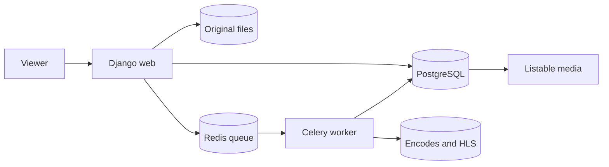

# Viewer

A viewer is a signed-in user without editor, manager, staff, or superuser powers. If approval is on, the viewer is approved.

## What a viewer can do

- Upload media, when the setting `CAN_ADD_MEDIA` allows it.
- Edit and delete own media.
- Open own private and unlisted media.
- Write comments, when the setting `CAN_COMMENT` allows it.
- Create playlists.
- Share media and copy embed code.
- Add captions to own media.
- Trim own video.

A viewer cannot open Manage pages or the admin portal. A viewer cannot review media.

## From upload to listable

1. The viewer uploads a file. MediaCMS sets the state from `PORTAL_WORKFLOW`.
2. For a video, Celery encodes the file. The encoding status becomes `success`.
3. If `MEDIA_IS_REVIEWED` is `False`, an editor marks the media as reviewed.
4. The media becomes listable when the state is public, the encoding succeeded, and the media is reviewed.

A viewer sees own media in the profile even when it is not listable.

## Common tasks

1. Select **Upload media**. See [Upload](../guides/user/upload.md).
2. Open your media. Select the edit option. See [Edit your media](../guides/user/edit.md).
3. Write a comment. See [Comments and mentions](../guides/user/comments.md).
4. Create a playlist. See [Playlists](../guides/user/playlists.md).
5. Share a media item. See [Share and embed](../guides/user/share.md).

## MediaCMS Architecture

## Scenarios

- [Viewer upload](../scenarios/viewer-upload.md)
- [Viewer comment](../scenarios/viewer-comment.md)
- [Viewer playlist](../scenarios/viewer-playlist.md)
- [Viewer share](../scenarios/viewer-share.md)
